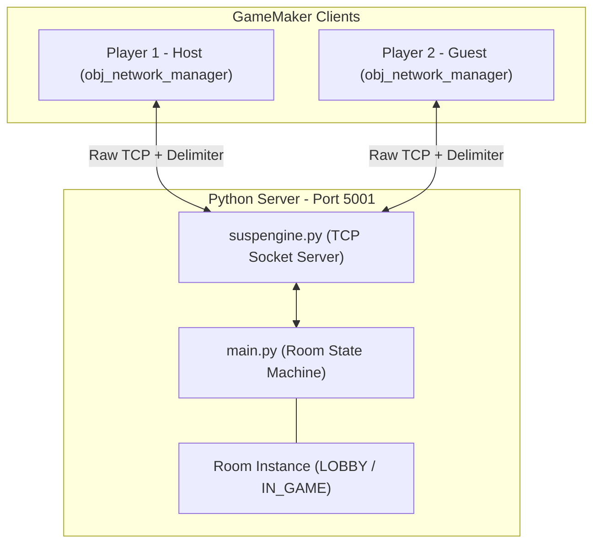
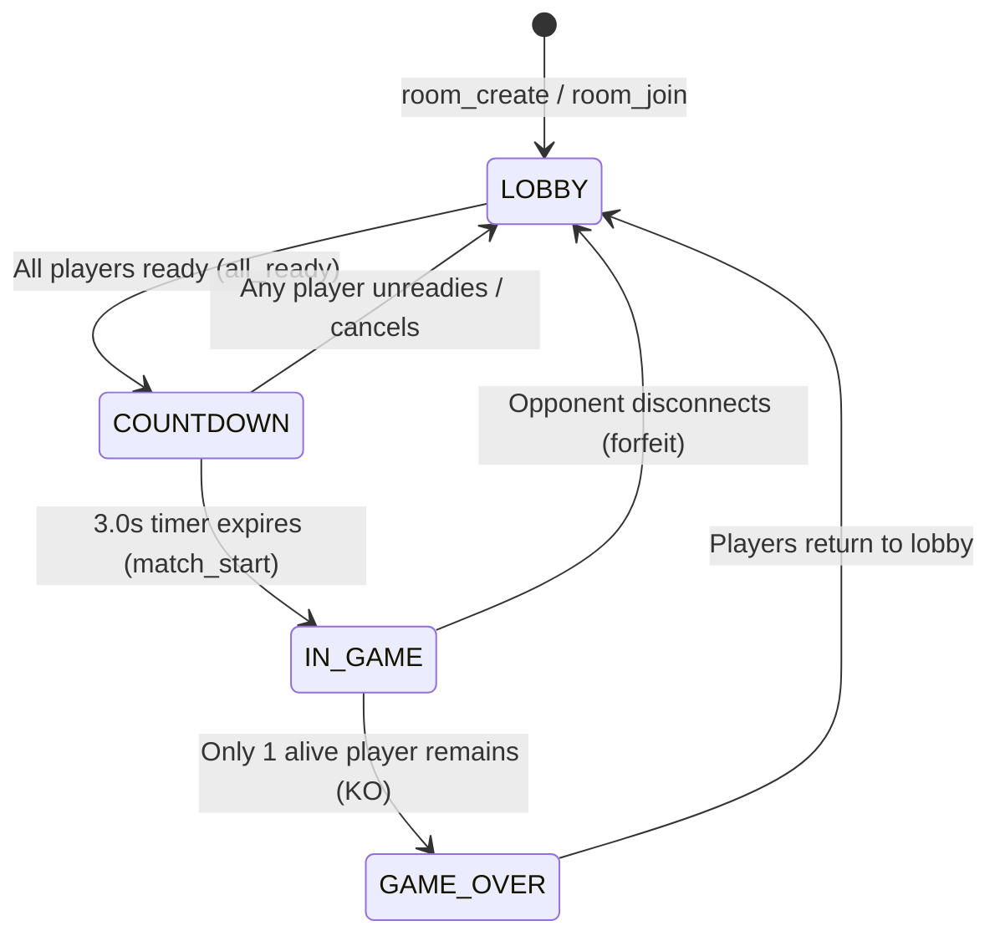
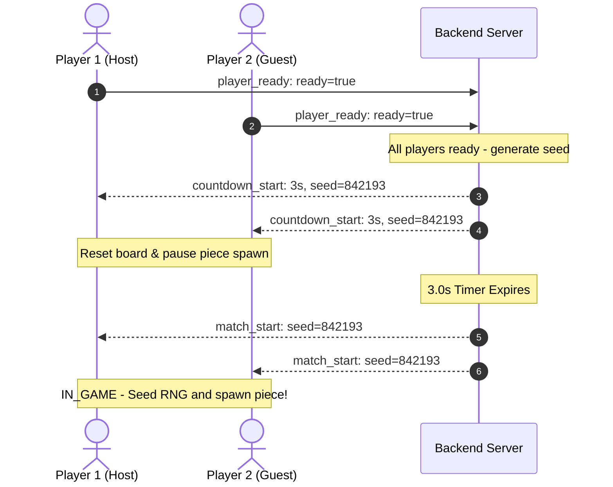
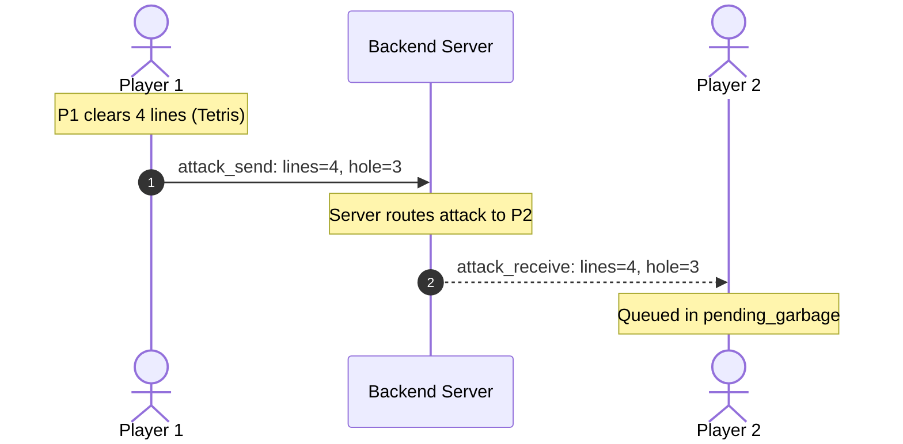

# Stacking Blocks: TCP Backend & Communication Architecture Guide

> **Audience**: New backend and gameplay engineers joining the project.  
> **Goal**: Rapidly understand how TCP networking, framing, rooms, and multiplayer state synchronization work between Python and GameMaker.

---

## 1. High-Level Architecture Overview

Stacking Blocks uses an authoritative, stateful TCP backend written in Python that manages matchmaking rooms, RNG synchronization, and garbage attack routing between GameMaker clients.



### Core Repository Locations

| Component | File Path | Responsibilities |
|---|---|---|
| **TCP Engine** | [`Backend/suspengine.py`](file:///d:/Projektoj/Stacking-Blocks/Backend/suspengine.py) | Raw socket listener, thread management, stream framing with delimiters, `@channel` event routing, and `emit`/`broadcast` primitives. |
| **Game Server** | [`Backend/main.py`](file:///d:/Projektoj/Stacking-Blocks/Backend/main.py) | Room lifecycle, slot allocation, ready countdown, synchronized RNG seed distribution, garbage attack routing, and disconnect cleanups. |
| **GM Network Manager** | [`Stacking Blocks/objects/obj_network_manager/`](file:///d:/Projektoj/Stacking-Blocks/Stacking%20Blocks/objects/obj_network_manager) | Client connection lifecycle, buffer reading, asynchronous event dispatching ([`Other_68.gml`](file:///d:/Projektoj/Stacking-Blocks/Stacking%20Blocks/objects/obj_network_manager/Other_68.gml)), piece sync throttling ([`Step_0.gml`](file:///d:/Projektoj/Stacking-Blocks/Stacking%20Blocks/objects/obj_network_manager/Step_0.gml)). |
| **GM Low-Level Extension** | [`Stacking Blocks/extensions/ext_suspendee/`](file:///d:/Projektoj/Stacking-Blocks/Stacking%20Blocks/extensions/ext_suspendee) | Low-level buffer creation, raw packet transmission (`network_emit.gml`). |

---

## 2. The TCP Framing & Delimiter Protocol

### Why Framing is Required
TCP is a byte-stream protocol, **not a message-oriented protocol**. Unlike UDP or WebSockets:
- A single call to send can be split into multiple chunks across the network (**fragmentation**).
- Multiple packets sent quickly back-to-back can arrive merged inside a single `recv` buffer (**packet concatenation**).

### The Delimiter Solution
Both ends frame messages using a special delimiter:
$$\text{Delimiter: } \texttt{[\{//V//\}]}$$

Every packet on the wire MUST end with this delimiter.

### Wire Format Specification
Every message is a JSON object with:
1. An event key matching the event name containing the data payload.
2. An `"identify"` key indicating the event name.
3. The trailing delimiter `[{//V//}]`.

```json
{"room_join": {"code": "ABCD", "name": "Player 2"}, "identify": "room_join"}[{//V//}]
```

```
+-----------------------------------------------------------+----------------+
| JSON String: {"<event>": { ...payload... }, "identify": "<event>"} | Delimiter: [{//V//}] |
+-----------------------------------------------------------+----------------+
```

---

## 3. How the Backend Works (`suspengine.py`)

`suspengine.py` is a lightweight, multi-threaded event-driven TCP server library.

### 3.1 Concurrency Model
- **Accept Loop Thread**: Listens on `0.0.0.0:5001`. On `s.accept()`, accepts a client socket `c` and spawns a daemon thread running `handleclient(c, addr)`.
- **Client Handler Threads**: Each connected client has its own dedicated `handleclient` thread looping on `c.recv(65536)`.
- **Event Dispatch Threads**: When a valid message is parsed, its registered `@channel` callback is launched inside a new daemon thread (`threading.Thread(...)`). This prevents a slow callback from blocking subsequent packet parsing for that socket.

### 3.2 Stream Reconstruction Algorithm
Because packets may be split or combined, `suspengine` maintains a per-client leftover string buffer in `prev[str(c)]`:

```python
# 1. Read raw bytes and decode
decoded_chunk = data.decode('utf-8', errors='ignore')

# 2. Prepend leftover buffer from previous recv
buffer = prev.get(str(c), "") + decoded_chunk

# 3. Split on delimiter
parts = buffer.split("[{//V//}]")

# 4. The last part is incomplete (or empty string if cleanly ended on delimiter)
prev[str(c)] = parts[-1]

# 5. All previous parts are complete JSON packets ready for execution
packets = parts[:-1]
```

### 3.3 Core Server API

```python
import suspengine

# Register an event handler
@suspengine.channel("event_name")
def on_event(client, addr, data):
    print(f"Received from {addr}: {data}")

# Send to one specific client socket
suspengine.emit("event_name", {"key": "value"}, client_socket)

# Broadcast to all connected clients (optionally excluding sender)
suspengine.broadcast("event_name", {"key": "value"}, exclude=client_socket)

# Start server (blocks current thread)
suspengine.server("0.0.0.0", 5001, slots=100, debug=True)
```

---

## 4. Room & Gameplay State Machine (`main.py`)

`main.py` contains the business logic for rooms, countdowns, RNG synchronization, and attacks.

### 4.1 Room Lifecycle



### 4.2 Room Class Internals
Each `Room` has:
- `code`: 4-character uppercase alphanumeric code (omits confusing letters `I` and `O`).
- `state`: `"LOBBY"`, `"COUNTDOWN"`, `"IN_GAME"`, `"GAME_OVER"`.
- `max_players`: Defaults to 2 (scalable for 1 vs Many).
- `players`: Dictionary mapping `client_socket -> player_info`:
  ```python
  {
      "slot": 0,           # Slot index: 0 = Local/Host, 1 = Opponent 1, etc.
      "name": "Player 1",
      "ready": False,
      "alive": True,
      "score": 0,
      "lines_cleared": 0
  }
  ```
- `match_seed`: Synchronized integer seed sent to all clients on `countdown_start` and `match_start` via `random_set_seed(seed)`. This guarantees all players receive identical piece sequences!

### 4.3 Thread-Safety Pattern (`room_lock`)
All access to `rooms_by_code` and `client_to_room` is protected by `room_lock = threading.RLock()`.

> [!IMPORTANT]
> **Re-entrant Lock & Broadcast Snapshotting**:
> `room_lock` is an `RLock` so a function can safely acquire it multiple times in the same thread. When calling `room.broadcast()`, the player list is snapshotted before emitting so that network I/O does NOT hold the lock across multiple `sendall()` calls.

---

## 5. GameMaker Client Architecture

### 5.1 Packet Emission (`ext_suspendee/network_emit.gml`)
When GM calls:
```gml
obj_network_manager.send_attack(lines, hole_col);
```
Under the hood, `network_emit("attack_send", _map)` creates a buffer, encodes `_map` into JSON, appends `global.splitter`, and executes `network_send_raw(global.server, netbuf, ...)`.

### 5.2 Async Network Event Dispatcher (`obj_network_manager/Other_68.gml`)
When data arrives on GameMaker's network socket (`network_type_data`):
1. Reads the buffer as a string.
2. Loops through `string_pos(global.splitter, tempstr)` to extract individual packets.
3. Decodes each packet via `json_decode`.
4. Dispatches directly based on `_pkt[? "identify"]`.

> [!NOTE]
> **Why Direct Dispatch?**
> Earlier builds used a dynamic `script_execute` dictionary, but GameMaker 2.3+ method variables (`function()`) cannot be called reliably via legacy `script_execute`. `Other_68.gml` uses direct `if/else if` dispatch for stability and speed.

---

## 6. Complete Packet Specification

### 6.1 Room & Matchmaking Packets

| Packet Identify | Sender | Payload Schema | Description |
|---|---|---|---|
| `room_create` | Client | `{"max_players": 2, "name": "Name"}` | Request server to create a new room. |
| `room_created` | Server | `{"code": "ABCD", "slot": 0, "max_players": 2, "name": "Name"}` | Confirms room creation; gives client their slot. |
| `room_join` | Client | `{"code": "ABCD", "name": "Name"}` | Join an existing room with 4-letter code. |
| `room_joined` | Server | `{"code": "ABCD", "slot": 1, "max_players": 2, "name": "Name"}` | Confirms room joined; assigns slot. |
| `room_error` | Server | `{"message": "Reason..."}` | Informs client of error (e.g., room full or not found). |
| `room_update` | Server | `{"code": "ABCD", "state": "LOBBY", "players": [...]}` | Full state broadcast whenever players join, leave, or ready. |
| `player_ready` | Client | `{"ready": true}` | Toggle player ready status in lobby. |
| `countdown_start` | Server | `{"seconds": 3, "seed": 583921}` | Countdown initiated; clients clear board & prep seed. |
| `match_start` | Server | `{"seed": 583921, "player_count": 2}` | Match starts! Active pieces spawn from synchronized seed. |
| `room_leave` | Client | `{"dummy": 1}` | Cleanly leave current room. |

### 6.2 In-Game Gameplay Packets

| Packet Identify | Sender | Payload Schema | Description |
|---|---|---|---|
| `piece_sync` | Client $\rightarrow$ Opponents | `{"slot": 0, "x": 512, "y": 1400, "shape": "T", "rot": 0}` | Throttled live position of active falling piece for smooth opponent ghost display. |
| `piece_locked` | Client $\rightarrow$ Opponents | `{"slot": 0, "lines_cleared": 2}` | Fired when a tetromino locks into the grid. |
| `attack_send` | Client $\rightarrow$ Server | `{"lines": 2, "hole_col": 3, "target_slot": -1}` | Outgoing garbage attack after line clearing & cancellation. |
| `attack_receive` | Server $\rightarrow$ Target Client | `{"lines": 2, "hole_col": 3}` | Delivered garbage rows queued into target's `pending_garbage`. |
| `player_ko` | Client $\rightarrow$ Server | `{"slot": 0}` | Player topped out past the ceiling. |
| `match_over` | Server | `{"winner_slot": 1, "winner_name": "P2", "reason": "..."}` | Match concluded; winner declared. |
| `ping` / `pong` | Client $\leftrightarrow$ Server | `{"client_time": 123456}` | Keepalive ping every ~3 seconds; measures RTT latency. |

---

## 7. Key Interaction Sequences

### 7.1 Game Start & Board Reset Sequence


### 7.2 Garbage Attack & Cancellation Sequence


---

## 8. Common Developer Gotchas & Tips

> [!WARNING]
> **Always Terminate Packets with Delimiter**:
> If sending raw test packets with Python test scripts or netcat, never send raw JSON alone. If you omit `[{//V//}]`, the engine will buffer the bytes indefinitely waiting for the message boundary.

> [!TIP]
> **Thread-Safe Data Modification**:
> Whenever reading or writing `rooms_by_code` or `client_to_room`, always use the `with room_lock:` block to prevent race conditions when multiple players disconnect or send attacks at the exact same millisecond.

> [!TIP]
> **Adding a New Event**:
> 1. In `Backend/main.py`: add `@suspengine.channel("my_event")` handler function.
> 2. In GameMaker `obj_network_manager/Other_68.gml`: add an `else if (_event == "my_event")` branch.
> 3. If GameMaker needs to send it: add a helper method in `obj_network_manager/Create_0.gml` that calls `network_emit("my_event", _data)`.
